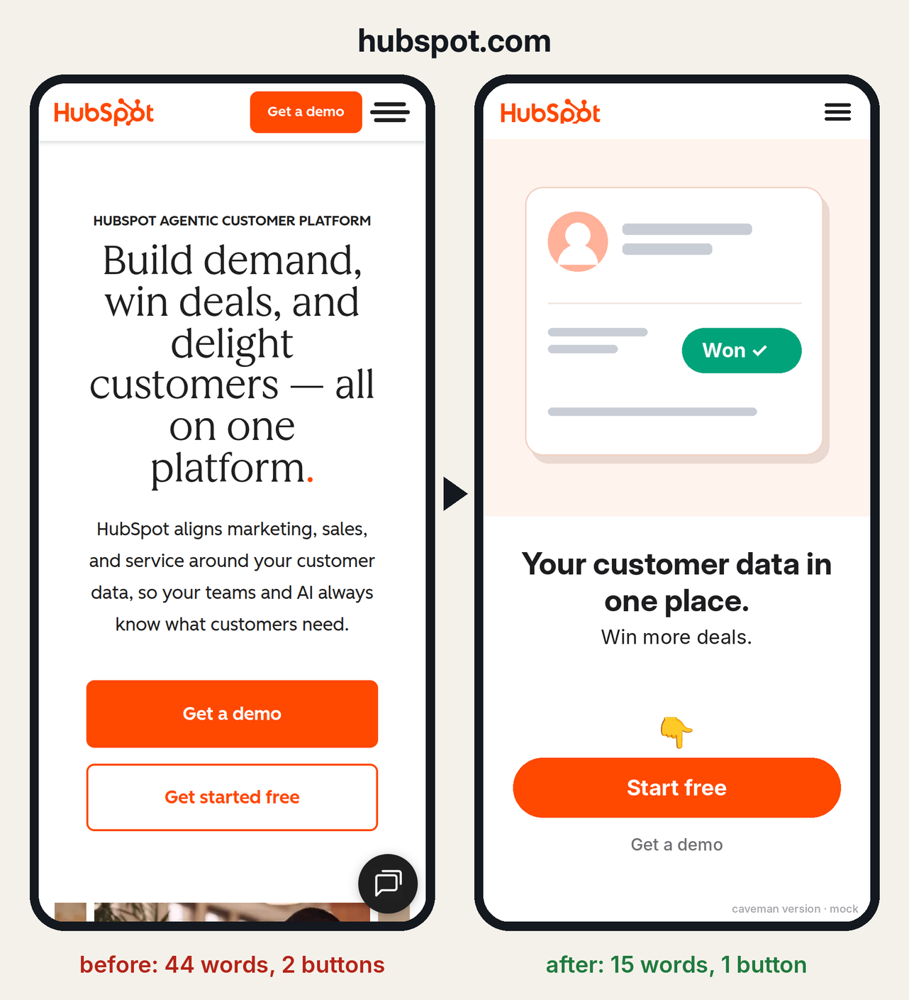
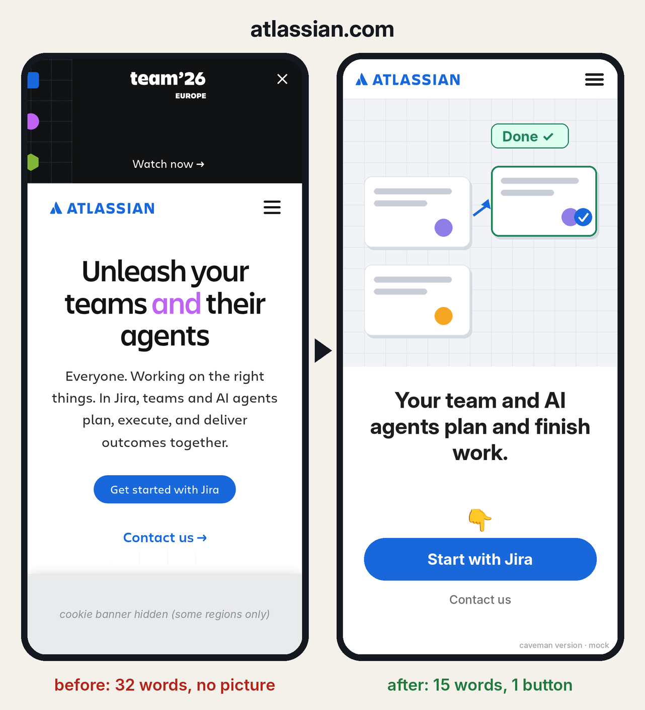
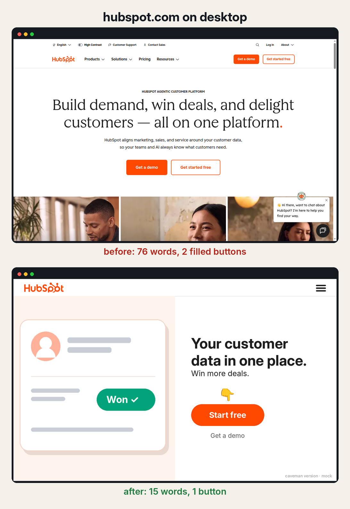

<div align="center">


# Caveman marketing


</div>


**Your AI agent cuts any ad, landing page or signup to one picture, 15 words and one button.**

```bash
npx skills add 5dive-ai/skills --skill caveman-marketing
```

## We ran it on famous homepages

Three fresh agents each got only this skill and one real homepage, on a phone, on 2026-10-20.
The real screenshot is on the left and the skill's version is on the right.






## On desktop too

The same rules on a 1440×900 screen. The picture takes the left half, and the words and the one button
sit on the right.



## The test

Look for 3 seconds, then cover the screen. Can you answer all three?

1. What is this?
2. Do I want it?
3. Where do I tap?

## The rules

1. A picture fills the top half.
2. 15 words max. Every word counts, buttons too.
3. One filled button, with 👇 above it. Nothing in the picture looks like a second one.
4. The button says what happens next.
5. A step bar on every step of a signup.
6. No words only your industry uses.
7. The signup ends when they get the thing.

`scripts/check.py` counts the words and buttons on each screen, because models miscount.
How the skill runs is in [SKILL.md](SKILL.md), and every example is in [examples/](examples/).

<sub>The right-hand screens are mocks, not the companies' pages. Each keeps the company's own
claims. Apple's picture is Apple's own photo; HubSpot's and Atlassian's are drawings. We're not
affiliated with any company shown.</sub>
